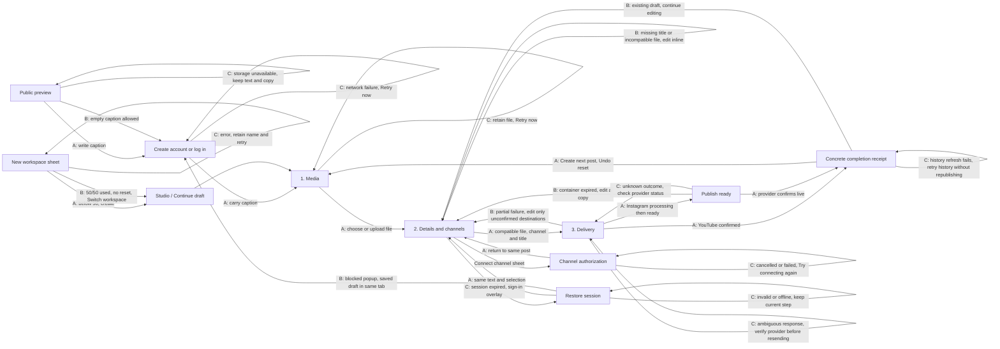

# Relay publishing journey

## Friction and drop-off diagnosis

- The landing page required signup before visitors could touch the product. `/try` now offers a live caption preview and carries its text into the first workspace draft.
- Studio previously sent new users through Channels and Library before opening the composer. Studio now opens or resumes the post; media selection and channel connection stay over the editor.
- YouTube's required title was hidden inside a platform tab. It now appears inline whenever a YouTube destination is selected, with its exact requirement beside the field.
- Session expiry discarded the user's screen, and failed delivery offered no clear continuation. Authentication now opens over the current step; delivery distinguishes provider processing, explicit Instagram confirmation, confirmed success, and unconfirmed results.

## Spatial and UX audit

- Workspace and page context remain at top left; connectivity lives at top right. Desktop editing has a large central canvas and a smaller preview. Whitespace separates sections.
- One filled action owns the current state: publish, confirm ready Instagram posts, or create the next post. Pickers and connections are layered dialogs. Mobile keeps the composer action bar above the persistent navigation and safe area.
- Draft text and selections survive navigation and refresh. Channel selection, attachment removal, and starting another post offer Undo. File failures retain the selected file in the open window.
- Local validation and upload recovery sit beside their fields. Actual service caps are shown without invented renewal dates: upload size is per file; the 50-workspace cap does not reset.

## State-machine map

Solid arrows are success or forward movement; labelled alternatives show partial and recovery branches. Sheets close back to their originating screen. No provider mutation is retried automatically.

## Screen and state specifications

| Surface | Goal and primary action | Carried context | Feedback and reversal | Empty, cap, and recovery copy |
| --- | --- | --- | --- | --- |
| Public preview | Write a caption and see it immediately. Create account CTA bottom right; pinned at bottom on mobile. | Caption saved under a separate preview key; adopted only when the workspace has no existing draft. | Immediate preview and exact character count. Native editing undo; text remains when storage fails. | “Your words will appear here.” / “2,200 characters” / “Browser storage is unavailable. Keep this tab open and copy your caption before creating an account.” |
| Account | Enter once, return to the requested screen. Submit bottom of form. | Preview caption and requested destination remain in browser storage. | Fixed form context; pending label; errors retain all fields. | Existing password length constraint / “Couldn’t reach Relay. Your details are still here.” + Retry now. |
| Studio | Start or resume a post. Single primary CTA top right. | Workspace, saved draft, real media/channel/history counts. | Click transitions horizontally to composer; persistent navigation and header. | “Your draft … is waiting. Pick up where you left off.” / first-post route remains available with zero media or channels. |
| 1. Media | Choose saved media or upload in place. Pickers layer over composer. | Caption, destination selection, media metadata and browser workspace pin. | Attached preview immediately; file upload status and inline Retry now; attachment removal offers Undo. | “Choose a photo or video to start your post.” / “{filename} is {size}. Choose a file no larger than {configured maximum}.” / “{filename} is still selected.” |
| 2. Details and channels | Finish caption/title and destinations; publish bottom right, pinned above mobile navigation. | File, caption, title, visibility, audience and channel selections. | Live preview and draft autosave; destination changes offer Undo; sole compatible destination defaults on library selection. | “{filename} is attached. Choose a channel above.” / “Add a title of 1–100 characters to continue.” / “This file cannot go to every selected channel. Choose a compatible file or remove that channel.” |
| Channel sheet | Connect a provider without leaving the post. Provider actions within sheet; Back to post below. | Full post and selected workspace. | Provider popup opens synchronously, buttons lock during authorization. Existing OAuth cancellation and retry remain available. | “Your post stays here while you connect.” / configuration issue opens setup / failed authorization has Try connecting again inside the sheet. |
| Session recovery | Restore access at current step. Sign in inside overlay. | In-memory payload and browser draft; file stays in the original window. | Same-origin message accepted only from the opened login window. No upload or publish automatically repeats. | “Sign in to continue this step” / “Your text and selections are still here.” / “Allow popups or continue in this tab. Your draft will reopen.” |
| 3. Delivery | Track each destination; explicit Publish ready for Instagram. | Post filename, destination names, visibility, provider IDs and confirmed status. | Immediate pending state; provider status checks; Instagram confirmation becomes primary when ready. No Undo claim for live publishing. | “{confirmed}/{total} destinations confirmed.” / Instagram ready is labelled “not live” / ambiguous publication requires provider verification before another send. |
| Completion | Read confirmation; Create next post is the next primary action. | Channel receipts, upload links and saved post metadata. | New post reset has Undo; successful destinations are omitted when editing a failed copy. | Concrete per-channel receipts; history errors retry reads without reissuing provider writes. |
| Workspace sheet | Create a workspace or switch to an existing one. Action at bottom. | Entered workspace name and active workspace. | Pending submission; errors retain the name. | “50/50 workspaces used. This cap does not reset. Switch to an existing workspace to continue.” + Switch workspace. |
| Library, Published, Insights | Reuse media, resume drafts, inspect delivery and learn from results. | Active workspace, current draft, history filter or analytics period. | Use in post opens composer directly. Error panels retry their own reads. | Empty history has Create a post; empty insights has Connect a channel; unavailable metrics have Manage channels. |

## Practical boundaries

Drafts are browser-local, not synchronized across devices. Storage restrictions are reported. Files remain selected only while the window stays open; only uploaded media IDs can survive a reload. OAuth provider consent and Instagram's explicit final publication confirmation add necessary actions to the usual three-node core loop. There is no billing or monthly publishing quota in this service. The live provider APIs were not called during verification.
